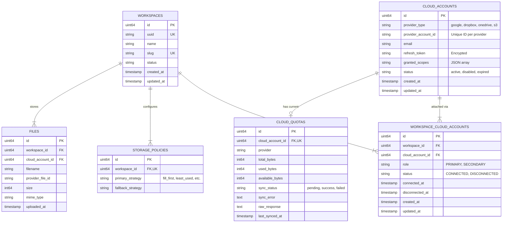
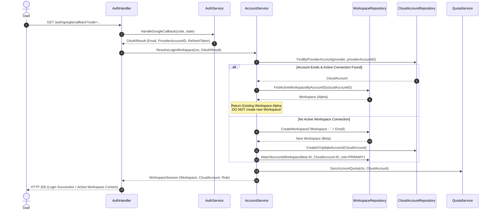
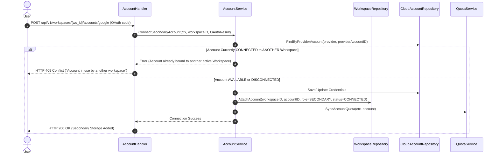

# Workspace Identity Redesign Architecture

## 1. Executive Summary & Domain Vision

This document details the architectural redesign of the identity model for **Cumulus** prior to implementing file uploads and storage scheduling.

In the initial milestones, `CloudAccount` served directly as the top-level identity. While sufficient for single-account authentication, this creates identity ambiguity and boundary conflicts when multiple cloud accounts (e.g., multiple Google Drive accounts, Dropbox, OneDrive) are attached to a single user environment.

### Core Redesign Principles

1. **Workspace as Root Aggregate**: The `Workspace` is the primary domain aggregate and identity root within Cumulus. All storage operations, quotas, file structures, and policies belong to a Workspace.
2. **CloudAccount as Storage Resource**: A `CloudAccount` represents a physical connected storage provider credential. It is an operational resource owned by a Workspace.
3. **Decoupled Identity vs. Storage (Junction Table Pattern)**: Identity membership is modeled via a `WorkspaceCloudAccount` junction entity. Physical cloud accounts can transition between `AVAILABLE`, `CONNECTED`, and `DISCONNECTED` states without losing historical data or corrupting existing account records.
4. **Primary vs. Secondary Account Roles**:
   - **PRIMARY**: Identifies the owning/login identity for the Workspace. Controls workspace management, billing, settings, and user access. Exactly one `PRIMARY` account exists per active Workspace.
   - **SECONDARY**: Acts exclusively as a storage capacity node consumed by the Upload Scheduler Engine.
5. **Idempotent Multi-Account Login**: Signing in with *any* active `CONNECTED` Google account (Primary or Secondary) resolves directly to its associated Workspace. The system never creates redundant Workspaces for connected accounts.

---

## 2. Domain & Entity Architecture

### 2.1 Entity Relationship Diagram (ERD)



---

## 3. Junction Table Tradeoff Analysis

### Why Junction Table (`workspace_cloud_accounts`) vs. Direct FK on `cloud_accounts`

| Architecture Aspect | Direct Foreign Key (`cloud_accounts.workspace_id`) | Junction Entity (`workspace_cloud_accounts`) |
| :--- | :--- | :--- |
| **Data Integrity on Disconnect** | Requires setting `workspace_id = NULL` or soft-deleting. Historical connection records are lost. | Sets relation `status = 'DISCONNECTED'` and records `disconnected_at`. Full connection history is preserved. |
| **Account Reusability** | Disconnecting an account requires mutating the core `CloudAccount` row or creating duplicate provider rows. | Setting relation to `DISCONNECTED` immediately transitions `CloudAccount` to `AVAILABLE`. It can be re-connected to another (or same) Workspace without mutating raw credentials. |
| **Single Active Membership Rule** | Enforced via simple index `UNIQUE(provider_account_id)`. | Enforced via PostgreSQL **Partial Unique Index**: `CREATE UNIQUE INDEX ... WHERE status = 'CONNECTED'`. |
| **Multi-User / Enterprise Readiness** | Weak. Cannot support future shared storage pools across organizational boundaries. | High. Allows future multi-tenant role assignment without schema changes. |
| **Decision** | ❌ **Rejected** (Causes data loss and tight coupling) | ✅ **Selected** (Clean Architecture compliant) |

---

## 4. Account Lifecycle & State Machine

### 4.1 CloudAccount Lifecycle States

```mermaid
stateDiagram-v2
    [*] --> AVAILABLE : OAuth Authenticated / Created
    
    AVAILABLE --> CONNECTED : Bounded to Workspace (as Primary or Secondary)
    
    CONNECTED --> DISCONNECTED : User explicitly disconnects account
    
    DISCONNECTED --> AVAILABLE : Connection unlinked; ready for re-attachment
    
    CONNECTED --> DISABLED : Refresh Token Revoked / Expired at Provider
    
    DISABLED --> CONNECTED : Re-authenticated & Refresh Token Updated
    
    DISCONNECTED --> CONNECTED : Re-connected to a Workspace
```

### State Definitions

1. **`AVAILABLE`**: The `CloudAccount` exists in the system with valid credentials, but is not currently bound to any active workspace (`status = 'CONNECTED'`).
2. **`CONNECTED`**: Active link exists in `workspace_cloud_accounts` with `status = 'CONNECTED'`. The account is participating in the Workspace pool.
3. **`DISCONNECTED`**: Unlinked from a Workspace. Historical files stored on this account remain tracked, but new uploads to this account are halted.
4. **`DISABLED` / `EXPIRED`**: Provider auth failure (e.g. user revoked permissions in Google Settings). System flags account for re-authentication.

---

## 5. Sequence Flows & Logic

### 5.1 Login Flow (Primary vs. Existing Connection Check)

When a user initiates OAuth from the main login page (`GET /auth/google`):



---

### 5.2 Connecting Additional Account Flow (`SECONDARY`)

When an authenticated user in Workspace Alpha clicks "Connect Additional Google Account":



---

### 5.3 Disconnecting Account Flow

```mermaid
sequenceDiagram
    autonumber
    actor User
    participant Handler as AccountHandler
    participant AccountUC as AccountService
    participant WS_Repo as WorkspaceRepository

    User->>Handler: DELETE /api/v1/workspaces/{ws_id}/accounts/{account_id}
    Handler->>AccountUC: DisconnectAccount(ctx, workspaceID, accountID)
    
    AccountUC->>WS_Repo: GetMembership(workspaceID, accountID)
    
    alt Account Role == PRIMARY
        AccountUC-->>Handler: Error ("Cannot disconnect Primary workspace account")
        Handler-->>User: HTTP 400 Bad Request ("Primary login account cannot be disconnected")
    else Account Role == SECONDARY
        AccountUC->>WS_Repo: UpdateMembershipStatus(workspaceID, accountID, status=DISCONNECTED)
        AccountUC-->>Handler: Success
        Handler-->>User: HTTP 200 OK ("Account disconnected; now AVAILABLE")
    end
```

---

## 6. PostgreSQL Database Schema & DDL

```sql
-- 1. Workspaces Table
CREATE TABLE IF NOT EXISTS workspaces (
    id BIGSERIAL PRIMARY KEY,
    uuid VARCHAR(36) NOT NULL UNIQUE,
    name VARCHAR(255) NOT NULL,
    slug VARCHAR(255) NOT NULL UNIQUE,
    status VARCHAR(50) NOT NULL DEFAULT 'active',
    created_at TIMESTAMP WITH TIME ZONE DEFAULT CURRENT_TIMESTAMP,
    updated_at TIMESTAMP WITH TIME ZONE DEFAULT CURRENT_TIMESTAMP
);

-- 2. Workspace Cloud Accounts Junction Table
CREATE TABLE IF NOT EXISTS workspace_cloud_accounts (
    id BIGSERIAL PRIMARY KEY,
    workspace_id BIGINT NOT NULL REFERENCES workspaces(id) ON DELETE CASCADE,
    cloud_account_id BIGINT NOT NULL REFERENCES cloud_accounts(id) ON DELETE CASCADE,
    role VARCHAR(50) NOT NULL DEFAULT 'SECONDARY', -- 'PRIMARY', 'SECONDARY'
    status VARCHAR(50) NOT NULL DEFAULT 'CONNECTED', -- 'CONNECTED', 'DISCONNECTED'
    connected_at TIMESTAMP WITH TIME ZONE DEFAULT CURRENT_TIMESTAMP,
    disconnected_at TIMESTAMP WITH TIME ZONE NULL,
    created_at TIMESTAMP WITH TIME ZONE DEFAULT CURRENT_TIMESTAMP,
    updated_at TIMESTAMP WITH TIME ZONE DEFAULT CURRENT_TIMESTAMP
);

-- Indexes for Workspace Cloud Accounts
CREATE INDEX IF NOT EXISTS idx_wca_workspace_id ON workspace_cloud_accounts(workspace_id);
CREATE INDEX IF NOT EXISTS idx_wca_cloud_account_id ON workspace_cloud_accounts(cloud_account_id);
CREATE INDEX IF NOT EXISTS idx_wca_status ON workspace_cloud_accounts(status);

-- CRITICAL Partial Unique Constraint:
-- Ensures a CloudAccount can be actively CONNECTED to at most ONE Workspace at a time.
CREATE UNIQUE INDEX IF NOT EXISTS idx_unique_active_cloud_account 
ON workspace_cloud_accounts(cloud_account_id) 
WHERE status = 'CONNECTED';

-- Ensures a Workspace has exactly ONE active PRIMARY account.
CREATE UNIQUE INDEX IF NOT EXISTS idx_unique_active_primary_per_workspace 
ON workspace_cloud_accounts(workspace_id) 
WHERE role = 'PRIMARY' AND status = 'CONNECTED';
```

---

## 7. Zero-Data-Loss Database Migration Strategy

To transition from the current schema (where `cloud_accounts` exist standalone) to the Workspace-centric identity model without data loss:

### Migration SQL Script (`migrations/0004_workspace_identity_redesign.sql`)

```sql
BEGIN;

-- Step 1: Create new Workspaces table
CREATE TABLE IF NOT EXISTS workspaces (
    id BIGSERIAL PRIMARY KEY,
    uuid VARCHAR(36) NOT NULL UNIQUE,
    name VARCHAR(255) NOT NULL,
    slug VARCHAR(255) NOT NULL UNIQUE,
    status VARCHAR(50) NOT NULL DEFAULT 'active',
    created_at TIMESTAMP WITH TIME ZONE DEFAULT CURRENT_TIMESTAMP,
    updated_at TIMESTAMP WITH TIME ZONE DEFAULT CURRENT_TIMESTAMP
);

-- Step 2: Create Junction Table
CREATE TABLE IF NOT EXISTS workspace_cloud_accounts (
    id BIGSERIAL PRIMARY KEY,
    workspace_id BIGINT NOT NULL REFERENCES workspaces(id) ON DELETE CASCADE,
    cloud_account_id BIGINT NOT NULL REFERENCES cloud_accounts(id) ON DELETE CASCADE,
    role VARCHAR(50) NOT NULL DEFAULT 'SECONDARY',
    status VARCHAR(50) NOT NULL DEFAULT 'CONNECTED',
    connected_at TIMESTAMP WITH TIME ZONE DEFAULT CURRENT_TIMESTAMP,
    disconnected_at TIMESTAMP WITH TIME ZONE NULL,
    created_at TIMESTAMP WITH TIME ZONE DEFAULT CURRENT_TIMESTAMP,
    updated_at TIMESTAMP WITH TIME ZONE DEFAULT CURRENT_TIMESTAMP
);

CREATE INDEX IF NOT EXISTS idx_wca_workspace_id ON workspace_cloud_accounts(workspace_id);
CREATE INDEX IF NOT EXISTS idx_wca_cloud_account_id ON workspace_cloud_accounts(cloud_account_id);

CREATE UNIQUE INDEX IF NOT EXISTS idx_unique_active_cloud_account 
ON workspace_cloud_accounts(cloud_account_id) 
WHERE status = 'CONNECTED';

CREATE UNIQUE INDEX IF NOT EXISTS idx_unique_active_primary_per_workspace 
ON workspace_cloud_accounts(workspace_id) 
WHERE role = 'PRIMARY' AND status = 'CONNECTED';

-- Step 3: Backfill Workspaces for existing CloudAccounts
-- Creates a dedicated Workspace for each existing CloudAccount
INSERT INTO workspaces (uuid, name, slug, status, created_at, updated_at)
SELECT 
    gen_random_uuid()::text,
    'Workspace - ' || email,
    'ws-' || id || '-' || LOWER(REGEXP_REPLACE(email, '[^a-zA-Z0-9]', '-', 'g')),
    'active',
    created_at,
    updated_at
FROM cloud_accounts
ON CONFLICT (slug) DO NOTHING;

-- Step 4: Backfill Junction Table entries marking existing accounts as PRIMARY & CONNECTED
INSERT INTO workspace_cloud_accounts (workspace_id, cloud_account_id, role, status, connected_at, created_at, updated_at)
SELECT 
    w.id AS workspace_id,
    ca.id AS cloud_account_id,
    'PRIMARY' AS role,
    'CONNECTED' AS status,
    ca.created_at AS connected_at,
    ca.created_at,
    ca.updated_at
FROM cloud_accounts ca
JOIN workspaces w ON w.name = 'Workspace - ' || ca.email
ON CONFLICT DO NOTHING;

COMMIT;
```

---

## 8. Domain Ports & Service Contracts

### 8.1 Domain Models (`internal/domain/models.go`)

```go
type AccountRole string

const (
	RolePrimary   AccountRole = "PRIMARY"
	RoleSecondary AccountRole = "SECONDARY"
)

type ConnectionStatus string

const (
	ConnectionStatusConnected    ConnectionStatus = "CONNECTED"
	ConnectionStatusDisconnected ConnectionStatus = "DISCONNECTED"
)

type Workspace struct {
	ID        uint64
	UUID      string
	Name      string
	Slug      string
	Status    string
	Accounts  []*WorkspaceCloudAccount
	CreatedAt time.Time
	UpdatedAt time.Time
}

type WorkspaceCloudAccount struct {
	ID             uint64
	WorkspaceID    uint64
	CloudAccountID uint64
	Role           AccountRole
	Status         ConnectionStatus
	Account        *CloudAccount // Eager/Lazy populated
	ConnectedAt    time.Time
	DisconnectedAt *time.Time
	CreatedAt      time.Time
	UpdatedAt      time.Time
}
```

### 8.2 Repository Ports (`internal/domain/ports.go`)

```go
type WorkspaceRepository interface {
	Create(ctx context.Context, ws *Workspace) error
	FindByID(ctx context.Context, id uint64) (*Workspace, error)
	FindBySlug(ctx context.Context, slug string) (*Workspace, error)
	FindActiveWorkspaceByCloudAccountID(ctx context.Context, cloudAccountID uint64) (*Workspace, error)
	
	AttachAccount(ctx context.Context, wca *WorkspaceCloudAccount) error
	UpdateAccountStatus(ctx context.Context, workspaceID, cloudAccountID uint64, status ConnectionStatus) error
	GetActiveAccounts(ctx context.Context, workspaceID uint64) ([]*CloudAccount, error)
}
```

---

## 9. Future Integration: How Upload Scheduler Consumes Workspace

When file upload endpoints are introduced in Milestone 4, the operation flow will bypass single user/account references and operate strictly on the Workspace aggregate:

```
[Upload Request] POST /api/v1/workspaces/:id/files
       │
       ▼
1. StorageService.UploadFile(ctx, workspaceID, fileHeader, payload)
       │
       ▼
2. WorkspaceRepository.GetActiveAccounts(ctx, workspaceID)
   └── Returns ALL active CONNECTED accounts (1 Primary + N Secondaries)
       with their updated CloudQuota metrics (Total, Used, Available)
       │
       ▼
3. SchedulerEngine.SelectAccount(ctx, activeAccounts, fileSize, strategy)
   └── Evaluates storage strategy (FillFirst, LeastUsed, MostAvailable, RoundRobin)
   └── Selects optimal CloudAccount target (Primary or Secondary)
       │
       ▼
4. ProviderAdapter.Upload(ctx, targetCloudAccount, chunkData)
```

---

## 10. Future Provider Extensibility (Dropbox, OneDrive, S3, NAS)

The redesigned identity model is completely agnostic to the underlying cloud provider:

1. `CloudAccount.ProviderType` accepts any provider identifier (`"google"`, `"dropbox"`, `"onedrive"`, `"s3"`, `"nas"`).
2. The junction table `workspace_cloud_accounts` binds the provider resource to the Workspace without assuming OAuth protocol specifics.
3. For non-OAuth providers (e.g. AWS S3 Access Keys or S3 Compatible / MinIO / Local NAS), the `CloudAccount` model will store encrypted JSON configurations in `RefreshToken` or a dedicated `Credentials` column.

---

## 11. Self-Challenge & Architectural Tradeoffs

### Challenge 1: What if a user wants to merge two Workspaces?
- **Analysis**: If Google Account A created Workspace Alpha, and Google Account B created Workspace Beta, what happens if the user later wants Account B attached to Workspace Alpha?
- **Solution**: The user logs into Workspace Alpha and runs "Connect Secondary Account", selecting Google Account B. Account B's membership in Workspace Beta transitions to `DISCONNECTED`. Workspace Beta remains accessible via Account B only if re-promoted, or can be archived. The partial unique index ensures Account B is `CONNECTED` to only Workspace Alpha.

### Challenge 2: Why not store user accounts separately from CloudAccounts?
- **Analysis**: In standard SaaS apps, a `User` table exists separately from `CloudAccount`.
- **Solution**: For Cumulus' current phase, a connected `PRIMARY` `CloudAccount` effectively represents the Workspace User. When multi-user team collaboration (`ADMIN`, `MEMBER`, `COLLABORATOR`) is introduced later, a `users` table can be added cleanly, with `workspace_users` handling human authorization while `workspace_cloud_accounts` continues handling cloud storage node attachment.

---

## 12. Summary Checklist for Next Milestone

- [x] Workspace aggregate root defined
- [x] Junction table `workspace_cloud_accounts` designed
- [x] Partial unique indexes for single active attachment and single Primary account defined
- [x] Idempotent login flow specified (prevents duplicate workspace creation)
- [x] Zero-data-loss database migration script provided
- [x] Upload scheduler interaction contract established
